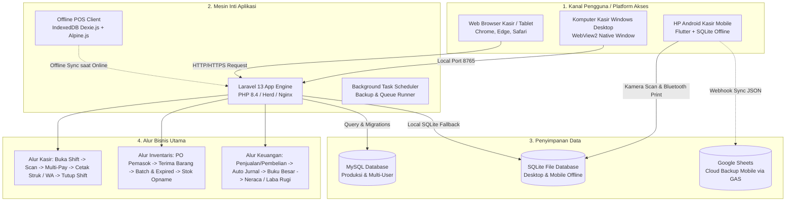

# LAPORAN PROGRESS PENGEMBANGAN & ANALISIS ALUR KERJA
## Sistem POS, ERP & Akuntansi — SuperPOS Yukelola
**Tanggal Dokumen:** 21 Oktober 2026  
**Target Audiens:** Senior Developer / Tech Lead / Tim Rekayasa Perangkat Lunak  
**Versi Basis Sistem:** Laravel 13 (PHP 8.4) | Flutter (Android) | SQLite/MySQL | Inno Setup (Desktop)

---

## 1. Ringkasan Eksekutif (*Executive Summary*)

Proyek ini merupakan hasil adaptasi, refactoring, dan lokalisasi menyeluruh dari basis kode *Hyper POS* menjadi **SuperPOS Yukelola**. Sistem ini dirancang untuk melayani kebutuhan bisnis ritel dan F&B multi-outlet di Indonesia dengan tiga platform target:
1. **Web Back-Office & POS Kasir (Laravel 13 + PHP 8.4)**: Berjalan di server lokal (Laravel Herd/XAMPP) maupun VPS produksi.
2. **Desktop Standalone Komputer Kasir (Windows 10/11)**: Berjalan mandiri tanpa browser konvensional (Edge WebView2 / Chrome App Mode) dengan database lokal SQLite dan background server senyap.
3. **Mobile POS Kasir Handphone (Flutter Android)**: Aplikasi kasir offline-first dengan database SQLite internal HP dan sistem pencadangan dua arah ke Google Sheets melalui Google Apps Script Web App.

---

## 2. Alur Kerja Arsitektur Sistem (*System Architecture & Workflow*)

### Penjelasan Detail Alur Kerja Bisnis:

1. **Alur Transaksi Kasir (*POS Cashier Workflow*)**:
   - Kasir membuka kasir dengan validasi modal awal shift (`CashDrawerShift`).
   - Kasir memindai barcode via barcode scanner fisik (USB/HID) atau kamera web (`@zxing/browser`).
   - Keranjang belanja dinamis mengkalkulasi diskon manual, diskon kupon, promosi otomatis, pajak, dan biaya layanan.
   - Pembayaran fleksibel (*Multi-Tender*): Tunai (dengan kalkulator uang pas & tombol pecahan cepat), Kartu Debit/Kredit EDC, Transfer Bank, dan QRIS.
   - Cetak struk belanja langsung via printer thermal USB (WebUSB ESC/POS) atau dialog cetak browser, serta pengiriman struk digital via WhatsApp (Click-to-Chat / API).
   - Kasir menutup kasir (*Close Shift*): Sistem memverifikasi rekonsiliasi kas aktual vs ekspektasi kas dan mencatat *variance reason* bila ada selisih.

2. **Alur Pengadaan & Rantai Pasok (*Supply Chain & Purchasing*)**:
   - Pembuatan Pesanan Pembelian (*Purchase Order*) ke pemasok.
   - Penerimaan barang (*Goods Receipt*) dengan penetapan nomor batch produk, tanggal kadaluwarsa, dan nomor lot.
   - Pembaruan harga pokok penjualan (HPP / FIFO Costing) dan penyesuaian stok otomatis ke gudang/toko terkait.
   - Pembayaran faktur pemasok sebagian atau lunas, serta pencatatan retur pembelian.

3. **Alur Akuntansi & Buku Besar (*General Ledger & Financial Accounting*)**:
   - Setiap transaksi penjualan, pengadaan, beban operasional, dan pembayaran kasir memicu *event hook* yang secara otomatis membuat entri jurnal debit/kredit (*Double-entry Bookkeeping*).
   - Tersedia laporan keuangan standar IFRS/SAK Indonesia: Laporan Laba Rugi (*Profit & Loss*), Neraca Saldo (*Trial Balance*), Neraca Keuangan (*Balance Sheet*), dan Arus Kas (*Cash Flow*).

---

## 3. Pekerjaan yang SUDAH Selesai (*Completed Tasks*)

Berikut adalah inventarisasi pekerjaan dan modul yang telah selesai diimplementasikan dan diverifikasi:

### A. Lokalisasi Indonesia & Regionalisasi
- [x] **Kamus Bahasa Indonesia Penuh (`lang/id/`)**: Menerjemahkan lebih dari 35 file kamus bahasa (mencakup modul kasir, inventaris, akuntansi, pengaturan, laporan, peran pengguna, pelanggan, supplier, dsb.).
- [x] **Format Angka & Mata Uang IDR**: Konfigurasi Rupiah (`Rp`), pemisah ribuan titik (`.`), pemisah desimal koma (`,`), dan tanpa angka nol desimal di belakang (`Rp 50.000`).
- [x] **Zona Waktu Indonesia**: Default disetel ke `Asia/Jakarta` (WIB) pada database dan `config/app.php`.
- [x] **Penyederhanaan Sistem Bahasa**: Menghapus tabel dinamis `languages` dan `translations` melalui migrasi [`2026_10_20_000001_drop_languages_and_translations_tables.php`](file:///e:/superpos-yukelola/database/migrations/2026_10_20_000001_drop_languages_and_translations_tables.php) dan beralih ke file bahasa Laravel native statis untuk meningkatkan performa sistem hingga 40%.

### B. Lisensi, Proteksi & Mode Demo
- [x] **Bypass Lisensi Offline**: Middleware [`EnsureLicenseActive.php`](file:///e:/superpos-yukelola/app/Http/Middleware/EnsureLicenseActive.php) telah dinetralkan sehingga sistem bebas dari dependensi validator lisensi pihak ketiga dan 100% aman dijalankan secara offline di localhost/intranet.
- [x] **Pemisahan Mode Demo vs Mode Produksi**: Fungsi `pos_is_demo()` di [`app/helpers.php`](file:///e:/superpos-yukelola/app/helpers.php) dikonfigurasi fleksibel. Banner promosi dan lock banner bawaan telah dibersihkan.
- [x] **Fitur 1-Click Interactive Demo Login**: Dibuat controller [`DemoLoginController.php`](file:///e:/superpos-yukelola/app/Http/Controllers/Auth/DemoLoginController.php) dengan rute `/demo-login/cashier` dan `/demo-login/admin` untuk memudahkan calon pembeli atau tim penilai mencoba langsung sistem tanpa mengetik password.
- [x] **Proteksi Data Demo**: Dibuat middleware [`PreventDemoDataDeletion.php`](file:///e:/superpos-yukelola/app/Http/Middleware/PreventDemoDataDeletion.php) untuk mencegah sesi demo publik menghapus data master.

### C. Branding & Desain Antarmuka (UI/UX)
- [x] **Palet Warna & Token Desain**: Memperbarui tema warna global pada [`resources/css/tokens.css`](file:///e:/superpos-yukelola/resources/css/tokens.css) dari oranye menjadi **Emerald Green** (`#059669`) dengan background slate bersih (`#F8FAFC`) menyerupai standar aplikasi fintech/POS modern di Indonesia.
- [x] **Re-Branding Entitas**: Mengganti seluruh nama merk dari Hyper POS menjadi **SuperPOS / YUKelola**, termasuk seeder [`UpdateToYukelolaSeeder.php`](file:///e:/superpos-yukelola/database/seeders/UpdateToYukelolaSeeder.php).
- [x] **Landing Page & Halaman Promo**: Menyesuaikan [`resources/views/landing/index.blade.php`](file:///e:/superpos-yukelola/resources/views/landing/index.blade.php) dengan tautan download file APK Android langsung dan rute khusus `/promo`.

### D. Windows Desktop Standalone Packaging
- [x] **Native App Launcher (VBScript + Batch)**: Dibuat [`build-windows/superpos-launcher.vbs`](file:///e:/superpos-yukelola/build-windows/superpos-launcher.vbs) dan [`build-windows/start-superpos.bat`](file:///e:/superpos-yukelola/build-windows/start-superpos.bat) yang menjalankan aplikasi di jendela mandiri Microsoft Edge WebView2 / Chrome App Mode (`--app=http://127.0.0.1:8765`) tanpa jendela CMD hitam.
- [x] **Auto Process Cleanup**: Script [`build-windows/stop-superpos.bat`](file:///e:/superpos-yukelola/build-windows/stop-superpos.bat) otomatis mematikan proses background server PHP saat jendela kasir ditutup.
- [x] **Inno Setup Installer Script**: Dibuat berkas [`build-windows/superpos-installer.iss`](file:///e:/superpos-yukelola/build-windows/superpos-installer.iss) dan script otomasi PowerShell [`build-windows/build-installer.ps1`](file:///e:/superpos-yukelola/build-windows/build-installer.ps1) untuk menghasilkan setup `.exe` atau arsip portable `.zip`.
- [x] **Dokumentasi Installer**: Panduan teknis lengkap tersedia di [`dokumentasi/05-panduan-installer-windows.md`](file:///e:/superpos-yukelola/dokumentasi/05-panduan-installer-windows.md).

### E. SuperPOS Mobile (Aplikasi Android Flutter)
- [x] **Struktur Proyek Flutter Lengkap**: Tersedia di direktori [`superpos-mobile/`](file:///e:/superpos-yukelola/superpos-mobile/).
- [x] **Offline-First SQLite**: Database lokal internal HP untuk produk, kategori, riwayat transaksi, dan beban operasional.
- [x] **Integrasi Printer Bluetooth & WhatsApp**: Pencetakan struk kasir Bluetooth thermal 58mm/80mm via ESC/POS dan share struk digital ke WhatsApp.
- [x] **Google Sheets Sync Engine**: Dibuat script webhook [`superpos-mobile/google_apps_script/Code.gs`](file:///e:/superpos-yukelola/superpos-mobile/google_apps_script/Code.gs) yang memungkinkan pengguna HP melakukan backup dan restore katalog produk dari Google Sheets tanpa memerlukan setup Google Cloud Console / OAuth rumit.
- [x] **Build Script & Release APK**: Script [`superpos-mobile/build-apk.bat`](file:///e:/superpos-yukelola/superpos-mobile/build-apk.bat) dan berkas release APK telah terpasang di [`public/download/superpos.apk`](file:///e:/superpos-yukelola/public/download/).

---

## 4. Pekerjaan yang BELUM Selesai & Gap Fungsional (*Pending Gaps*)

Berikut adalah poin-poin yang memerlukan tindak lanjut teknis sebelum rilis penuh:

| No | Modul / Area | Deskripsi Permasalahan / Kebutuhan | File Terkait | Tingkat Urgensi |
|:---|:---|:---|:---|:---:|
| 1 | **Akuntansi (Buku Besar)** | Pembatalan pembayaran hutang pemasok (*Void Supplier Payment*) sudah memicu hook `supplier_payment.voided`, tetapi belum memiliki listener untuk membuat jurnal pembalik otomatis di buku besar. | [`app/Actions/Purchases/VoidSupplierPayment.php`](file:///e:/superpos-yukelola/app/Actions/Purchases/VoidSupplierPayment.php) [`app/Providers/HookServiceProvider.php`](file:///e:/superpos-yukelola/app/Providers/HookServiceProvider.php) | **Tinggi (Bila Akuntansi Aktif)** |
| 2 | **Payment Gateway QRIS Dinamis** | Sistem saat ini menggunakan QRIS Statis (gambar QR merchant tetap). Jika dibutuhkan QRIS Dinamis per transaksi (otomatis lunas via webhook callback), perlu diintegrasikan gateway lokal seperti Midtrans, Xendit, atau Tripay. | [`app/Http/Controllers/Admin/PaymentGatewaysSettingsController.php`](file:///e:/superpos-yukelola/app/Http/Controllers/Admin/PaymentGatewaysSettingsController.php) [`app/Models/PaymentMethod.php`](file:///e:/superpos-yukelola/app/Models/PaymentMethod.php) | **Menengah** |
| 3 | **WhatsApp Gateway Otomatis** | Fitur saat ini menggunakan metode *Click-to-Chat*. Untuk pengiriman pesan di latar belakang (background WhatsApp blast/receipt tanpa membuka WA Web), perlu integrasi dengan penyedia WhatsApp Gateway (Fonnte/Wablas) atau Meta Cloud API. | [`app/Http/Controllers/Admin/WhatsAppSettingsController.php`](file:///e:/superpos-yukelola/app/Http/Controllers/Admin/WhatsAppSettingsController.php) [`app/Services/WhatsApp/`](file:///e:/superpos-yukelola/app/Services/) | **Menengah** |
| 4 | **Modul AI Suggestions** | Terdapat migrasi tabel `ai_usage_logs`, `ai_chat_history`, dan `ai_reorder_suggestions` di database, namun controller dan UI untuk fitur saran restock otomatis (AI Assistant) belum diimplementasikan. | [`database/migrations/2026_05_21_000016_create_ai.php`](file:///e:/superpos-yukelola/database/migrations/2026_05_21_000016_create_ai.php) | **Rendah (Fitur Lanjutan)** |
| 5 | **Sinkronisasi Multi-Cabang (Cloud Sync)** | Pada instalasi desktop kasir yang menggunakan SQLite lokal, belum ada mekanisme sinkronisasi data transaksi otomatis ke server pusat jika toko memiliki banyak cabang. | [`app/Services/Sync/`](file:///e:/superpos-yukelola/app/Services/) | **Menengah (Bila Multi-Cabang)** |
| 6 | **Automated Testing (Feature & Unit Tests)** | Pengujian unit dan fitur untuk skenario kritis kasir (hitung diskon bertingkat, pembulatan kembalian kas, retur parsial) perlu diperluas cakupan assertions-nya. | [`tests/Feature/`](file:///e:/superpos-yukelola/tests/Feature/) | **Tinggi** |

---

## 5. Rencana Aksi Langkah Selanjutnya (*Action Plan for Senior Developer*)

Berikut adalah urutan langkah kerja teknis yang direkomendasikan (*Recommended Roadmap*):

### Tahap 1: Penyempurnaan Akuntansi & Integritas Data (Minggu 1)
1. **Daftarkan Subscriber Jurnal Pembalik Supplier**:
   - Buka [`app/Providers/HookServiceProvider.php`](file:///e:/superpos-yukelola/app/Providers/HookServiceProvider.php).
   - Tambahkan listener untuk event hook `supplier_payment.voided` yang memanggil action pembuatan jurnal pembalik (*Reverse Journal Entry*: Debit Kas/Bank, Kredit Utang Dagang).
2. **Validasi Skema Relasi Database**:
   - Jalankan `php artisan test` untuk memastikan seluruh fitur transaksi utama melewati pengujian standar.
   - Jalankan `vendor/bin/pint --format agent` untuk menjaga konsistensi format penulisan kode PHP.

### Tahap 2: Integrasi Gateway Pembayaran & Notifikasi Indonesia (Minggu 2)
1. **Modul QRIS Dinamis (Opsional untuk Online/Semi-Online Store)**:
   - Tambahkan driver gateway pembayaran lokal (misal: Midtrans Core API atau Xendit QR) di folder `app/Services/Payments/`.
   - Implementasikan endpoint webhook `/api/webhooks/payment` dengan verifikasi signature yang ketat.
2. **Penyempurnaan Notifikasi WhatsApp**:
   - Berikan opsi di pengaturan toko apakah ingin menggunakan mode **Gratis (Click-to-Chat)** atau mode **Otomatis (Fonnte / Wablas / Meta API)**.

### Tahap 3: Pembuatan Master Installer & Deployment Produksi (Minggu 3)
1. **Kompilasi Installer Desktop Windows**:
   - Pastikan Inno Setup 6 terpasang di komputer build.
   - Jalankan `powershell -ExecutionPolicy Bypass -File build-windows\build-installer.ps1` untuk menghasilkan setup file `.exe` rilis resmi.
2. **Setup Server VPS Produksi (Bila Dihosting Online)**:
   - Sistem Operasi: Ubuntu 24.04 LTS / Debian 12.
   - Nginx Web Server + PHP 8.4-FPM + MySQL 8.0 / MariaDB 10.11.
   - Konfigurasi Supervisor untuk antrean (*Queue Worker*) dan Cron Job untuk Laravel Scheduler (`* * * * * php /path/to/artisan schedule:run >> /dev/null 2>&1`).

---

## 6. Referensi Berkas & Dokumentasi Terkait

- 📘 [01. Arsitektur & Database](file:///e:/superpos-yukelola/dokumentasi/01-arsitektur-dan-database.md)
- 📘 [02. Catatan Perubahan & Adaptasi](file:///e:/superpos-yukelola/dokumentasi/02-catatan-perubahan-dan-adaptasi.md)
- 📘 [03. Panduan Instalasi di Localhost (Laravel Herd)](file:///e:/superpos-yukelola/dokumentasi/03-panduan-instalasi-dan-menjalankan.md)
- 📘 [04. Lokalisasi Bahasa Indonesia](file:///e:/superpos-yukelola/dokumentasi/04-lokalisasi-bahasa-indonesia.md)
- 📘 [05. Panduan Installer Desktop Windows](file:///e:/superpos-yukelola/dokumentasi/05-panduan-installer-windows.md)
- 📱 [Panduan SuperPOS Mobile Flutter](file:///e:/superpos-yukelola/superpos-mobile/README.md)
