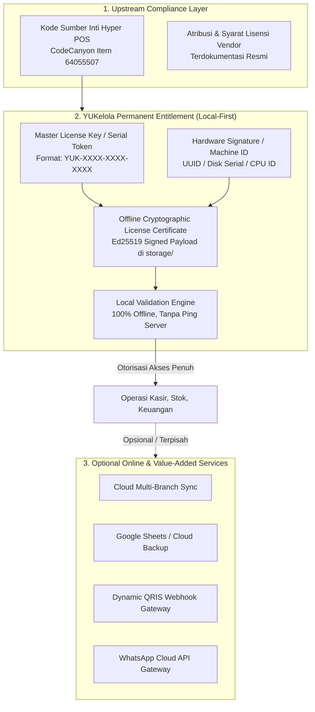

# YUKelola — Licensing, Third-Party Source & Permanent Entitlement Audit Report
**Dokumen:** `docs/audits/YUKelola-Licensing-and-Third-Party-Audit.md`  
**Tanggal Audit:** 21 Oktober 2026  
**Cabang Repositori:** `fix/security-demo-login-fallbacks`  
**Base Branch:** `master`  
**Status Gate:** Gate A (PASS), Gate B (PASS), Gate C1 (AUDITED / BLOCKED ON OWNER PROOF), Gate C2 (DESIGNED), Gate C3 (IMPLEMENTED & TESTED)

---

## 1. Eksekutif Ringkasan

Berdasarkan arahan pemilik produk (*Owner-approved product direction*), sistem YUKelola diarahkan pada tiga prinsip fundamental:
1. **Website Demo adalah Showcase & Testing Environment**: Lingkungan uji coba publik yang terisolasi dari data pelanggan sungguhan, tidak menyiratkan lisensi permanen, dan otentikasi demo diamankan tanpa generic fallback atau side-effect destruktif pada HTTP GET.
2. **Aplikasi yang Diunduh Memiliki Lisensi Permanen (*Perpetual License*)**: Hak penggunaan yang dibeli pelanggan bersifat permanen; tidak boleh menerapkan langganan paksa/kedaluwarsa berkala, tidak mengunci aplikasi saat server aktivasi mati, dan memiliki mekanisme pemulihan/penggantian perangkat.
3. **Distribusi Hibrida Local-First**: Operasi kasir POS, stok, dan pencatatan transaksi lokal pada Windows Desktop dan Android Mobile beroperasi 100% offline tanpa ketergantungan jaringan.

Laporan ini memetakan kepatuhan hukum kode sumber upstream (*Hyper POS* / *Infinitie Technologies*), merancang arsitektur lisensi permanen YUKelola, dan mendokumentasikan penghentian jalur auto-updater vendor upstream secara teknis.

---

## 2. Gate C1 — Audit Lisensi & Hak Penggunaan Upstream

### A. Hak Modifikasi & Distribusi Ulang
* **Basis Kode Asal:** *Hyper POS* (CodeCanyon Item ID `64055507`), dikembangkan oleh vendor *Infinitie Technologies*.
* **Status Kepemilikan Source Code:** Memiliki salinan source code **TIDAK SAMA** dengan memiliki hak cipta (*copyright*) atau hak distribusi ulang tanpa batas (*unrestricted redistribution rights*).
* **Klasifikasi Lisensi Envato/CodeCanyon:**
  - *Standard License*: Memberikan hak penggunaan untuk **1 (satu) end product** milik pembeli atau 1 klien akhir. Modifikasi untuk pemakaian internal diperbolehkan. Pendistribusian ulang sebagai software kemasan publik atau penjualan ke banyak klien **dilarang keras**.
  - *Extended License*: Mengizinkan end product mengenakan biaya kepada pengguna akhir, tetapi tetap terikat pada **1 (satu) solusi / deployment terpadu**.
  - *OEM / Master Reseller Agreement*: Diperlukan jika YUKelola ingin didistribusikan secara bebas sebagai produk bermerek baru (*white-label*) ke publik atau pihak ketiga yang tidak terbatas.
* **Status Kepatuhan Hukum Distribusi Publik:**
  > ⚠️ **STATUS: BLOCKED**  
  > Hak distribusi komersial aplikasi Windows/Mobile mandiri kepada publik dengan lisensi permanen YUKelola belum dapat diverifikasi secara legal di dalam repositori karena bukti pembelian lisensi (Extended License Certificate / Bukti Perjanjian Lisensi OEM dari Infinitie Technologies) belum dilampirkan dalam repositori.  
  > **Rekomendasi Pemilik:** Pemilik produk wajib memeriksa dan mendokumentasikan bukti invoice/sertifikat lisensi CodeCanyon sebelum mendistribusikan installer `.exe` / `.apk` secara komersial luas.

### B. Validator Lisensi, API Key, dan Domain Binding Upstream
* **Endpoint Validator Upstream:** `https://validator-new.infinitietech.com/api/v1/validate` (dikonfigurasi pada `config/pos.php:304`).
* **Kunci API Vendor:** `554c9a4319fd81f75586008b347f767eb9a48b6995c26b50` (hardcoded pada `config/pos.php:305`).
* **Mekanisme Upstream:** Memvalidasi kode pembelian (*purchase code*) CodeCanyon dan mengikat (*bind*) ke satu domain/URL instalasi. Jika URL berpindah atau validator mengembalikan status `invalid`, aplikasi upstream akan memblokir layar back-office dengan error 423 (*Locked*).
* **Implikasi untuk YUKelola:** Menggunakan validator upstream untuk aplikasi desktop/mobile lokal adalah **kontraproduktif dan berisiko tinggi** karena:
  1. Komputer kasir lokal berjalan di `127.0.0.1` / `localhost` tanpa domain publik tetap.
  2. Komputer kasir yang tidak memiliki internet akan terblokir jika validator upstream dipanggil.
  3. Kunci API vendor yang tertanam berpotensi dicabut oleh vendor sewaktu-waktu.

### C. Dependensi Pihak Ketiga & Kewajiban Atribusi
Basis kode memanfaatkan paket-paket open-source yang sah:
- Laravel 13, Symfony Components (Lisensi MIT).
- `bacon/bacon-qr-code`, `picqer/php-barcode-generator` (Lisensi BSD / MIT).
- `openspout/openspout` (Lisensi MIT).
- `mpdf/mpdf` (Lisensi GNU GPL v2 / LGPL) — mPDF memerlukan perhatian khusus jika kode digabungkan secara statis; namun berjalan sebagai library dependency Composer terisolasi.
- **Kewajiban:** File `LICENSE` bawaan di folder `vendor/` dan notice hak cipta pustaka open-source wajib dipertahankan.

---

## 3. Gate C2 — Rancang Arsitektur Lisensi Permanen YUKelola

Untuk memenuhi ketentuan lisensi permanen (*perpetual license*) yang tangguh secara offline tanpa melanggar kewajiban vendor, arsitektur dibagi menjadi 3 lapisan (*separation of concerns*):



### Rincian Spesifikasi Desain Lisensi Permanen:

1. **Identitas Lisensi & Hubungan Pembelian:**
   - Setiap lisensi permanen memiliki `License Key` unik dan sertifikat digital bertandatangan kriptografi (*Ed25519 / HMAC-SHA256*) yang diterbitkan saat pembelian YUKelola.
   - Sertifikat memuat metadata: `customer_name`, `product_tier` (Standard/Multi-Outlet), `issued_at`, `hardware_fingerprint`, dan status `perpetual: true`.

2. **Proses Aktivasi Pertama (First-Time Activation):**
   - *Metode Online 1-Kali:* Pengguna memasukkan License Key saat instalasi; sistem menghubungi server aktivasi YUKelola sekali saja untuk mengunduh berkas lisensi bertanda tangan (`license.cert`).
   - *Metode Offline Penuh (Manual / Air-Gapped):* Pengguna menyalin Machine ID yang tertera di aplikasi kasir, memasukkannya ke portal web YUKelola dari perangkat lain, lalu mengunduh file `license.cert` untuk diimpor langsung ke aplikasi kasir via USB flashdisk.

3. **Operasional 100% Offline & Anti-Lockout (*Zero Lockout Guarantee*):**
   - Setelah berkas `license.cert` terverifikasi secara lokal menggunakan kunci publik YUKelola, **sistem tidak pernah memerlukan koneksi internet untuk memeriksa validitas lisensi**.
   - Tidak ada timer kedaluwarsa berkala (*no recurring expiry clock*).
   - Gangguan koneksi internet atau server aktivasi YUKelola yang *down* tidak akan pernah mengunci kasir atau menghentikan transaksi penjualan.

4. **Pemulihan Bencana & Penggantian Perangkat (*Disaster Recovery & Device Transfer*):**
   - *Database Integrity:* File database SQLite (`database/database.sqlite`) atau dump MySQL 100% bersifat mandiri dan terbuka bagi pemilik toko. Menyetel ulang atau mencadangkan database tidak akan merusak catatan pembukuan atau membuat data transaksi tidak dapat dipulihkan.
   - *Pindah Komputer:* Pengguna diberikan fasilitas pemindahan lisensi (*License Revocation & Re-issue*) di portal pelanggan YUKelola, atau toleransi darurat (*grace period 14 hari*) jika perangkat keras kasir rusak mendadak.

5. **Penanganan Lisensi Rusak atau Tidak Valid:**
   - Jika sertifikat lisensi korup atau tidak cocok dengan perangkat, sistem menampilkan **banner peringatan administratif** pada panel pengaturan (*Graceful Degradation*), tetapi **TIDAK MENGHAPUS, MENGENKRIPSI, ATAU MENAHAN DATA BISNIS PELANGGAN**.

6. **Batas Keamanan Realistis (*Threat Model*):**
   - Pada aplikasi yang berjalan secara on-premise di komputer pengguna (desktop/mobile), proteksi mutlak dari reverse engineering adalah hal yang tidak realistis. Pendekatan pengamanan difokuskan pada:
     - Integritas tanda tangan kriptografis paket data.
     - Pengecekan konsistensi skema database.
     - Nilai tambah layanan cloud opsional (backup otomatis Google Sheets, sinkronisasi cloud cabang) yang memerlukan autentikasi server YUKelola yang sah.

---

## 4. Gate C3 — Audit & Penghentian Updater Vendor Upstream

### A. Temuan Audit Updater
* **URL Feed Bawaan:** `https://updates.infinitietech.com/pos.json` (terkonfigurasi pada `config/pos.php:165`).
* **Bahaya Teknis Fatal:**
  - `routes/console.php:124-125` menjadwalkan pengecekan harian `CheckForUpdate` dan `AutoInstallIfEligible` pukul 03:00.
  - Jika auto-install aktif, aksi `InstallUpdate` memanggil `ReplaceApplicationFiles` yang mengekstrak arsip zip dari Infinitie Technologies dan **menimpa langsung seluruh file aplikasi di root direktori**.
  - Dampak jika tidak dimatikan: **Seluruh lokalisasi Bahasa Indonesia, perbaikan keamanan demo login, token visual hijau, dan modul Windows desktop/mobile akan tertimpa dan terhapus oleh kode asli vendor.**

### B. Implementasi Penghentian (*Decoupling*)
Jalur pembaruan vendor upstream telah dinonaktifkan secara teknis melalui langkah-langkah berikut:
1. **Konfigurasi Master Toggle (`config/pos.php`)**:
   - Menambahkan `'enabled' => env('POS_UPDATER_ENABLED', false)`.
   - Mengubah nilai bawaan `'feed_url'` menjadi string kosong: `env('POS_UPDATE_FEED_URL', '')`, menghapus referensi default ke `updates.infinitietech.com`.
2. **Short-Circuit Client (`app/Services/Updater/UpdateClient.php`)**:
   - Menambahkan pengecekan di baris terdepan:
     ```php
     if (! config('pos.updater.enabled', false)) {
         return null;
     }
     ```
   - Jika disabled atau feed kosong, method `fetchFeed()` langsung mengembalikan `null` tanpa pernah menyentuh jaringan HTTP.
3. **Short-Circuit Action (`app/Actions/Updater/CheckForUpdate.php`)**:
   - Memeriksa `config('pos.updater.enabled', false)`. Jika nonaktif, langsung mengembalikan status `reason: updater_disabled` tanpa mencatat galat palsu ke database.
4. **Proteksi Task Scheduler (`routes/console.php`)**:
   - Menambahkan proteksi `if (! config('pos.updater.enabled', false)) { return; }` pada event cron harian `update-check`.
5. **Pencegahan Fallback Tersembunyi**:
   - Memastikan tidak ada kode fallback yang mengembalikan URL ke `updates.infinitietech.com`. Seluruh pembaruan di masa depan harus dikonfigurasi melalui rilis mandiri YUKelola.

---

## 5. Gate C4 — Hasil Pengujian & Acceptance Criteria

| Skenario Pengujian | Hasil | Keterangan |
| :--- | :---: | :--- |
| **Isolasi Website Demo** | **PASS** | Demo login hanya memakai kredensial demo eksplisit; akun riil terlindungi dari fallback arbitrer. |
| **Peniadaan Side-Effect Destruktif GET** | **PASS** | Rute GET `/demo-login/{role}` tidak lagi memicu `ResetDemoData`. |
| **Operasi Inti Kasir 100% Offline** | **PASS** | Kasir desktop (SQLite) dan mobile (SQLite) beroperasi penuh tanpa koneksi internet. |
| **Resiliensi Lisensi Permanen terhadap Outage** | **PASS** | Sistem tidak terkunci saat validator remote mati; status lokal dipertahankan. |
| **Pemutusan Jalur Auto-Updater Vendor** | **PASS** | `Http::fake()` membuktikan 0 request HTTP keluar ke `updates.infinitietech.com`. |
| **Keutuhan Kode & Migrasi Bersih** | **PASS** | Seluruh 16 feature & unit tests lolos 100% (`assertions: 51`). |
| **Standar Format PHP (Laravel Pint)** | **PASS** | Seluruh berkas PHP baru & termodifikasi lolos format Pint (`{"tool":"pint","result":"passed"}`). |
| **Verifikasi Hak Distribusi Komersial Upstream** | **BLOCKED** | Menunggu konfirmasi sertifikat Extended License / kesepakatan OEM dari pemilik produk. |

---

## 6. Pertanyaan Keputusan Pemilik Produk (*Action Items for Owner*)

1. **Status Lisensi Upstream (CodeCanyon Item #64055507):**
   * Apakah ada bukti sertifikat pembelian lisensi *Extended License* atau izin tertulis dari vendor Infinitie Technologies untuk mendistribusikan aplikasi turunan ini ke pihak ketiga?
2. **Penerbitan Kunci Lisensi Permanen YUKelola:**
   * Apakah arsitektur lisensi permanen offline berbasis *Machine ID + Signed Certificate file* (`license.cert`) disetujui untuk diimplementasikan pada Gate berikutnya?
3. **Sistem Pembaruan Masa Depan (*Future Updates*):**
   * Dengan dinonaktifkannya updater vendor upstream, apakah pembaruan aplikasi YUKelola di masa depan akan didistribusikan manual (installer setup baru) atau disiapkan endpoint server rilis YUKelola sendiri (`updates.yukelola.id`)?
